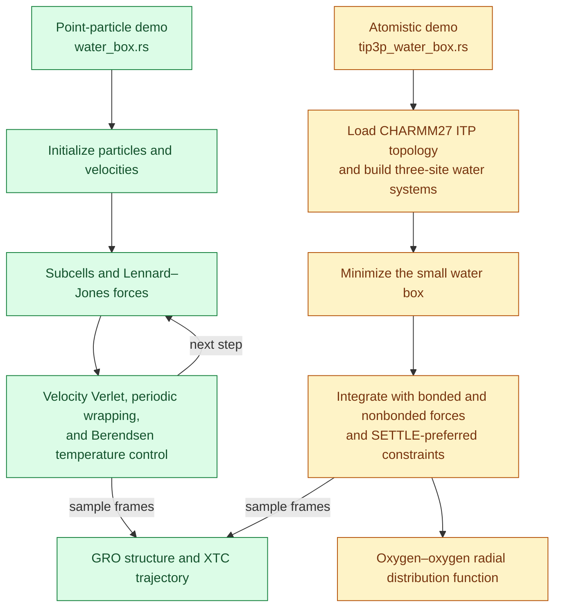
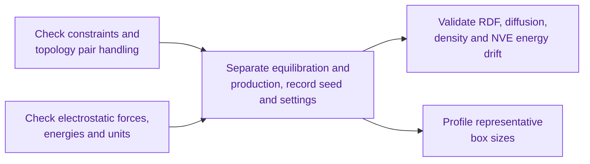

# FerrumMD development guide

FerrumMD is a Rust molecular dynamics project. Start with the point-particle example to get familiar with the code, then follow the TIP3P path to see how molecular topology, constraints, and electrostatics fit together.

🟢 **Available today** · 🟡 **Implemented, needs broader validation** · 🟣 **Proposed work**

## Trace a simulation



| Status | Where to start | What to look for |
| --- | --- | --- |
| 🟢 | [Point-particle water box](../src/bin/water_box.rs) | The shortest complete example. Follow the initial force calculation, the two velocity half-steps, the position update, and the sampled trajectory frames. |
| 🟡 | [Martini water box](../src/bin/martini_water_box.rs) | The coarse-grained demo models water using beads. Validate the chosen parameters and observables before using it for a study. |
| 🟡 | [TIP3P water box](../src/bin/tip3p_water_box.rs) | Builds a 27-molecule box, minimizes it, initializes the dynamics, and integrates with the thermostat disabled. The example prints a preliminary O–O RDF. |
| 🟡 | [ITP parser](../src/molecule/martini.rs) and [molecular system](../src/molecule/molecule.rs) | The parser already reads `[ settles ]`, `[ exclusions ]`, and `[ pairs ]`. Follow `to_system` to see how topology becomes runtime data. |
| 🟡 | [Simulation kernels](../src/lennard_jones_simulations.rs) and [constraints](../src/molecule/shake_rattle.rs) | Follow the molecular integration loop for bonded forces, neighbor-list updates, electrostatics, and constraint enforcement. |
| 🟢 | [Trajectory I/O](../src/molecule/io.rs) | Converts the simulation state into GRO structures and XTC frames shared by the examples. |

### Run the first example

From the repository root, with stable Rust and a C compiler available:

```bash
cargo build --locked
cargo test --locked
repo_dir=$(pwd)
output_dir=$(mktemp -d)
(cd "$output_dir" && cargo run --locked --manifest-path "$repo_dir/Cargo.toml" --bin water_box)
```

The example reports 256 particles and 21 frames. Keeping its outputs in a separate directory also helps when working with the Martini and TIP3P demos, which have example trajectories checked into the repository and write to those same filenames. The TIP3P executable resolves its force-field inputs relative to the working directory.

> [!NOTE]
> Select the binary explicitly with `--bin`. The separate `sang_md` demo currently opens a force-field file through an author-specific absolute path. Fixing that path is a small CLI portability task.

## What to develop next

The [TIP3P roadmap](../README.md#-tip3p-roadmap-to-full-simulation-fidelity) and [water-box TODO](../TODO.md) record the original goals. The sequence below starts from what is now in the checkout.



| Next change | Evidence to look for in the PR |
| --- | --- |
| 🟣 Exercise the existing rigid-water and topology code end to end. | A small fixture loaded through the ITP parser preserves O–H and H–H distances during integration. Exclusion and special-pair tests cover both Lennard–Jones and Coulomb contributions where applicable. |
| 🟣 Extend electrostatics regression checks. | The existing analytic charge-pair and small-cluster tests provide a baseline. Add reference energy and force comparisons for the configured periodic real-space and reciprocal-space path. |
| 🟣 Make the simulation protocol reproducible. | A fixed seed and recorded configuration reproduce a small trajectory. Minimization, equilibration, and production have explicit boundaries and thermostat settings. |
| 🟣 Validate water-box observables. | Compare the existing O–O RDF and new MSD-based diffusion estimates against reference data at matching conditions. Track energy drift in NVE and density under a protocol that allows volume to vary. |
| 🟣 Benchmark the molecular force loop. | Track steps per second on repeatable box sizes and compare neighbor-list and electrostatics costs before optimizing. |

For a first contribution back, start with a focused test for one behavior in the table. The [existing library tests](../src/lib.rs) show how the project builds small systems and checks analytic forces.
